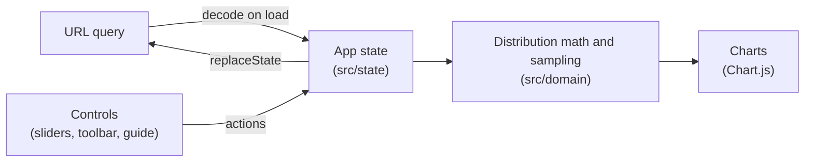

# Probability Distribution Visualizer

An interactive web app for exploring probability distributions. Move a parameter slider and the probability density (PDF) or probability mass (PMF) chart updates immediately.

## Key Features

- “Find by use case” page: choose an illustrated type of quantity and a concrete situation, check a candidate distribution with its assumptions and limitations, then open its chart. No knowledge of distribution names is needed.
- 10 distributions in learning order: Bernoulli, binomial, Poisson, geometric, negative binomial, normal, log-normal, exponential, gamma, and beta.
- Parameter sliders and number inputs, with an optional sample histogram shown on the same chart as the theoretical curve.
- Use-case text for each distribution that includes numbers computed from the current parameters.
- Shareable URLs: the query string keeps parameters, sample settings, card visibility and order, the use-case toggle, the guide page with its category and case, and any theme or language chosen explicitly.
- Japanese and English text, and light and dark themes.

## Application Flow



## Tech Stack

| Area | Tools |
| --- | --- |
| Frontend | React, TypeScript, Vite |
| Charts | Chart.js (canvas). Distribution math and random sampling are implemented in `src/domain` |
| Styling | Tailwind CSS |
| Quality | Biome, Vitest |
| Environment | Docker, Docker Compose |

## Local Development

The project is fully containerized, so Node.js does not need to be installed on your host machine.

### Quick Start

```bash
# Start dev server (http://localhost:5173)
docker compose up
```

### Development Commands

Run quality checks and test suites through the container:

```bash
# Unit tests
docker compose run --rm app npm test

# TypeScript type verification
docker compose run --rm app npm run typecheck

# Lint & formatting check
docker compose run --rm app npm run lint

# Production build
docker compose run --rm app npm run build
```

## Analytics

Production-only GA4 tracks content navigation, graph exploration, and feedback. See [measurement definitions and dashboard guidance](docs/analytics.md) for event meanings and verification.

## Deployment

Pushing to the `main` branch runs [the deploy workflow](.github/workflows/deploy.yml), which runs lint, type checks, tests, and the build, then deploys to GitHub Pages. The one-time Pages setting is described at the top of that workflow.
